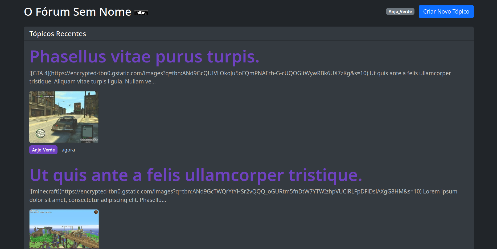

# Forum Sem Nome



**Forum Sem Nome** is an anonymous forum developed as the **last project for the Cloud Computing course**. Its main goal was to deploy a web application to **AWS** and configure **continuous deployment with GitHub Actions**, so that changes pushed to the repository would automatically update the deployed website.

The application lets users create discussion threads and posts anonymously. Its frontend uses Bootstrap for the interface, while the backend provides a REST API built with FastAPI and SQLModel.

## Technologies

- **Frontend:** HTML, CSS, JavaScript, and Bootstrap
- **Backend:** Python, FastAPI, and SQLModel
- **Database:** PostgreSQL hosted on Amazon RDS
- **Containers:** Docker and Docker Compose
- **Cloud platform:** Amazon Web Services (AWS)
- **CI/CD:** GitHub Actions
- **Web server:** Nginx

## Features

### Backend
- REST API for discussion threads and posts
- Anonymous nicknames generated from a noun and an adjective
- Markdown support
- PostgreSQL database connection through Amazon RDS

### Frontend
- Thread list ordered by most recent reply
- Creation of new posts
- Thread view with comments
- Anonymous user identification using `localStorage`
- Responsive interface styled with Bootstrap

### Automated deployment
- Deployment workflow defined in `deploy-main.yml`
- Intended to run when changes are pushed to the `main` branch
- Docker image rebuilds and application restart through Docker Compose

## Project Structure

```text
anonymous-forum/
├── backend/
│   ├── Dockerfile
│   ├── requirements.txt
│   ├── main.py
│   ├── models.py
│   ├── database.py
│   └── config.py
├── frontend/
│   ├── Dockerfile
│   ├── nginx.conf
│   ├── index.html
│   ├── create-post.html
│   ├── thread.html
│   ├── style.css
│   ├── script.js
│   └── config.js
├── deploy-main.yml
├── docker-compose.yml
└── .env
```

## Deployment Overview

The deployment workflow was designed around the following steps. **Note:** GitHub Actions only discovers workflow files stored in `.github/workflows/`. If `deploy-main.yml` is currently in the repository root, move it to `.github/workflows/deploy-main.yml` for GitHub Actions to execute it automatically.

1. Prepare the AWS environment and provision the required resources.
2. Configure the application and its environment variables.
3. Configure the required GitHub repository secrets for deployment.
4. Push a commit to the `main` branch.
5. Let GitHub Actions rebuild the Docker images and restart the application on AWS.
6. Verify that the updated website is available.

## Running the Project Locally

Make sure Docker and Docker Compose are installed. Configure the required environment variables before starting the application.

Build and start the services from the project root:

```bash
docker compose up --build -d
```

To inspect the service status:

```bash
docker compose ps
```

To follow the logs:

```bash
docker compose logs -f
```

To stop the application and remove its containers and network:

```bash
docker compose down
```

> **Note:** The environment variables and database connection must match your setup. Do not commit credentials or production secrets to the repository. Configure deployment credentials using GitHub repository secrets.
