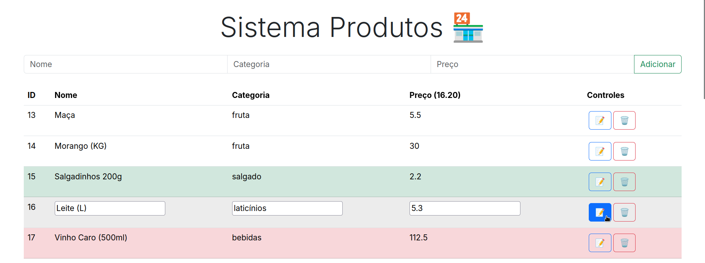

# Product Management System - Persistence Assignment 01

A simple product management web application developed for the first assignment of the **Persistence** course. It provides a browser-based interface for managing products and a REST API that stores product data in a CSV file.



## Features

- Create, list, view, update, and delete products.
- Store each product's name, category, and price.
- Persist product data in a CSV file (`server/src/data.csv`).
- Retrieve the products with the highest and lowest prices.
- Calculate the average product price and filter products by whether their price is above or below that average.
- Explore and test the API through FastAPI's automatically generated documentation.

## Tech Stack

**Frontend**
- HTML
- JavaScript with Vite
- Bootstrap
- Axios (available in the client dependencies)

**Backend**
- Python, managed with uv
- FastAPI
- Pydantic
- Pandas and NumPy
- CSV-based file persistence

## Project Structure

```text
.
├── client/
│   ├── src/
│   │   ├── index.html
│   │   ├── js/
│   │   └── scss/
│   ├── package.json
│   └── vite.config.js
├── showcase.png
└── server/
    ├── data_backup/
    │   └── data.csv
    ├── src/
    │   ├── data.csv
    │   └── server.py
    ├── pyproject.toml
    └── uv.lock
```

## Getting Started

### Prerequisites

- Python
- [uv](https://docs.astral.sh/uv/)
- Node.js and npm

### 1. Start the backend

Install and synchronize the backend dependencies from the `server` directory, then start the API in development mode:

```bash
cd server
uv sync
uv run fastapi dev src/server.py
```

The API will be available at `http://127.0.0.1:8000`. FastAPI's interactive API documentation is available at `http://127.0.0.1:8000/docs`.

### 2. Start the frontend

Open a second terminal and run:

```bash
cd client
npm install
npm run dev
```

Open the local URL printed by Vite in the terminal.

## API Endpoints

### Product operations

| Method | Endpoint | Description |
| --- | --- | --- |
| `POST` | `/produtos` | Create a product. |
| `GET` | `/produtos` | List all products. |
| `GET` | `/produtos/{id}` | Retrieve a product by ID. |
| `PUT` | `/produtos/{id}` | Update a product by ID. |
| `DELETE` | `/produtos/{id}` | Delete a product by ID. |

A product request body uses the following fields:

```json
{
  "nome": "Notebook",
  "categoria": "Electronics",
  "preco": 2500.0
}
```

### Price analysis

| Method | Endpoint | Description |
| --- | --- | --- |
| `GET` | `/produtos/max-price` | Retrieve the most expensive product. |
| `GET` | `/produtos/min-price` | Retrieve the least expensive product. |
| `GET` | `/produtos/mean` | Get the average price of all products. |
| `GET` | `/produtos/higher-than-mean` | List products priced at or above the average. |
| `GET` | `/produtos/less-than-mean` | List products priced below the average. |

### Health check

| Method | Endpoint | Description |
| --- | --- | --- |
| `GET` | `/ping` | Return a simple `pong` response. |

## Data Persistence

Product records are loaded from `server/src/data.csv` when the backend starts. Changes made through the API are written back to this file, allowing the data to persist between application restarts.

## Academic Context

This project was developed as **Assignment 01** for the Persistence course (2025.2).
